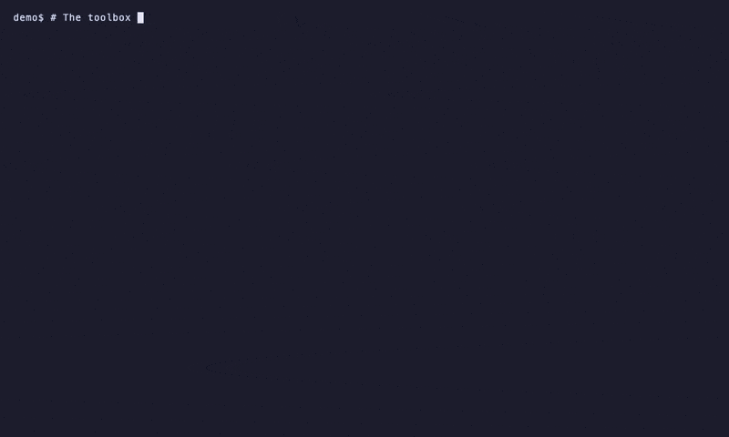

# vibe-demo-gif

How the animated README GIF in
[imagewize/mistral-toolbox](https://github.com/imagewize/mistral-toolbox) was made:
a terminal recording of a Mistral Vibe **agent using skills**, cut down to a small GIF.

Result (committed to mistral-toolbox as `docs/assets/vibe-agent-demo.gif`, commit `c101f89`):



- 800px wide, 27s, 1.7 MB, 10 fps, 32 colors
- Shows `vibe --agent wp-reviewer` in `~/code/mistral-toolbox` reviewing the latest commit:
  the agent loads the `code-review` skill on demand (`Loading skill: code-review`), runs git /
  grep checks, and ends with an `OVERALL ASSESSMENT: Approve` report with `file:line` findings

## Rebuild

Everything is relative to this repo — run from the repo root on a machine with
`vhs`, `ffmpeg`/`ffprobe`, `jq`, `gifsicle` and `vibe` (mistral-toolbox skills wired into
`~/.vibe/config.toml`, agents linked into `~/.vibe/agents`):

```bash
./build.sh              # record (vhs vibe-agent-demo.tape), cut, shrink
./build.sh --cut-only   # reuse the existing vibe-agent-demo.mp4, just cut + shrink
```

`*.mp4` is gitignored, so `--cut-only` needs a local recording whose timings match the
`SEGMENTS` plan in `build.sh` (otherwise the last segment truncates or overruns).

`build.sh` runs three steps:

1. **Record**: `vhs vibe-agent-demo.tape` → `vibe-agent-demo.mp4` (1200x720, Catppuccin Mocha,
   10 fps). The tape types real commands in a PTY; the demo target is `~/code/mistral-toolbox`.
2. **Cut**: `./mp4-to-gif.sh vibe-agent-demo.mp4 vibe-agent-demo-raw.gif "$SEGMENTS"` —
   `start:end:speed` segments, activity at 1x, frozen tool-wait stretches at 12x, empty end on
   the last segment = run to the end. `mp4-to-gif.sh` is an unmodified copy of
   `~/code/seo-strategy/scripts/mp4-to-gif.sh`. Its palette step uses `COLORS=64`.
3. **Shrink**: `gifsicle -O3 --colors 32 --lossy=120` → the final 32-color GIF
   (4.0 MB → 1.7 MB). The 32 colors come from this gifsicle step, not from the converter.

The exact segment plan for the committed recording is the `SEGMENTS` string in `build.sh`:

```
0.00:2.12:12 2.12:3.72:1 3.72:15.52:12 15.52:17.40:1 17.40:19.60:12 19.60:21.40:1
21.40:80.00:12 80.00:81.12:1 81.12:97.80:12 97.80:99.40:1 99.40:172.12:12 172.12:173.92:1
173.92:182.12:12 182.12:183.60:1 183.60:200.12:12
```

After a **fresh** recording the timings differ — regenerate the plan with
`./mp4-to-gif.sh --detect vibe-agent-demo.mp4` (lists `freeze_start/end` pairs of 2s+ with no
screen change), merge freezes with gaps < 1s, and alternate activity (1x) / freeze (12x) over
`[0, duration]`. 200s recording → 27s GIF.

The recorded vibe command (see the tape):

```bash
vibe --auto-approve --output streaming --agent wp-reviewer -p 'Review the diff of the latest commit (HEAD) for README.md and CHANGELOG.md only; report severity-ranked findings with file:line.' 2>/dev/null | jq --unbuffered -R -r -f pretty.jq
```

(In the tape the command runs after `cd ~/code/mistral-toolbox`, so it uses `-f ~-/pretty.jq`:
`~-` expands to `$OLDPWD`, the repo root, and avoids a `$` that VHS would interpolate.)

`pretty.jq` turns the `--output streaming` NDJSON events into readable terminal text: `effect`
events print the tool summary (`Loading skill: code-review`, `bash: git diff …`), assistant
`message` events print the narration and the final report. It accepts `content` as an array of
blocks or a plain string, and uses `fromjson` without `?` so a non-JSON line aborts loudly
instead of being silently dropped.

## Gotchas (VHS 0.12.1 + vibe 3.1.0, learned the hard way)

- **`Type` interpolates `$VAR`** in tape strings — `"$HOME/..."` fails with
  `Invalid command: HOME/...`. Use single-quoted shell args inside the double-quoted `Type`
  string; a bare `$ ` (as in `PS1='demo$ '`) is safe.
- **Wait regexes need a single backslash** in the tape file — VHS 0.12.1 passes the pattern
  through literally, so `/^\\$$/` (double backslash) never matches. The tape sidesteps
  end-anchor brittleness entirely: it sets a unique prompt (`export PS1='demo$ '`) and waits
  for `/demo\$/`. A trailing space in the captured prompt line also breaks `/^\$$/`-style
  end-anchored patterns.
- **Don't `Wait+Line` inside the interactive TUI**: it uses an alternate screen, so Wait only
  sees the footer, never the scrolled report. Record headless (`-p`), not the TUI.
- **`vibe -p` (text mode) buffers everything until exit** — the recording is one static screen,
  then the whole answer at once. Use `--output streaming` (NDJSON) piped through
  `jq --unbuffered -R -r -f pretty.jq`.
- **Headless `-p` denies tool calls without approval** ("Tool execution denied by approval
  callback") even for folders in `~/.vibe/trusted_folders.toml` — add `--auto-approve`.
- **`2>/dev/null` hides the MCP-connection noise but also real stderr.** To keep real errors
  visible while filtering the noise:
  `vibe … 2> >(grep -v '^MCP server' >&2) | jq …`
- **lossy=120 is aggressive but verified readable**: frames extracted from the shipped GIF
  (mid-run tool calls and the final report) keep text crisp at 800px. If another recording
  smears, back off to `gifsicle -O3 --colors 64 --lossy=80` (~2.5 MB).

## Feedback for Vibe (upstream)

- `-p` text mode buffers until exit; line-streamed text output would remove the need for the
  NDJSON + `pretty.jq` workaround.
- Headless mode ignores `trusted_folders.toml` and still denies tool calls without
  `--auto-approve`, so a read-only review demo has to show a scary-looking flag.
- MCP connection failures go to stderr, forcing `2>/dev/null` (which hides real errors too).
- A two-file review took ~200s, mostly frozen waiting on tool calls (sped up 12x in the GIF) —
  worth a look at turn latency for small scopes.

## Alternatives

- **asciinema + agg** (`brew install asciinema agg`): `asciinema rec demo.cast` then
  `agg demo.cast demo.gif`. Same caveat: `vibe -p` text mode buffers, so record an interactive
  session or the streaming+jq pipe.
- **Webpage animations** (not terminal): headless-Chrome recorder
  `~/code/architect-demo/scripts/demo-gif.rec.mjs` — drives Chrome over the DevTools protocol,
  captures frames on a scroll timeline, encodes with ffmpeg concat → gifski →
  `gifsicle -O3 --colors 32 --lossy=30`. That is how `architect-demo/images/demo.gif`
  (the Bureau Kadewerk homepage recording) was made.

## Files

- `build.sh` — record → cut → shrink, with the committed `SEGMENTS` plan
- `vibe-agent-demo.tape` — the VHS tape (relative paths; run from the repo root)
- `pretty.jq` — NDJSON → readable text filter for `vibe --output streaming`
- `mp4-to-gif.sh` — unmodified copy of the seo-strategy converter (detect + segments)
- `vibe-agent-demo.gif` — the final GIF (as embedded in the mistral-toolbox README)
- `LICENSE.md` — MIT © Imagewize

`.mp4` recordings and intermediate `*-raw.gif` files are gitignored.
